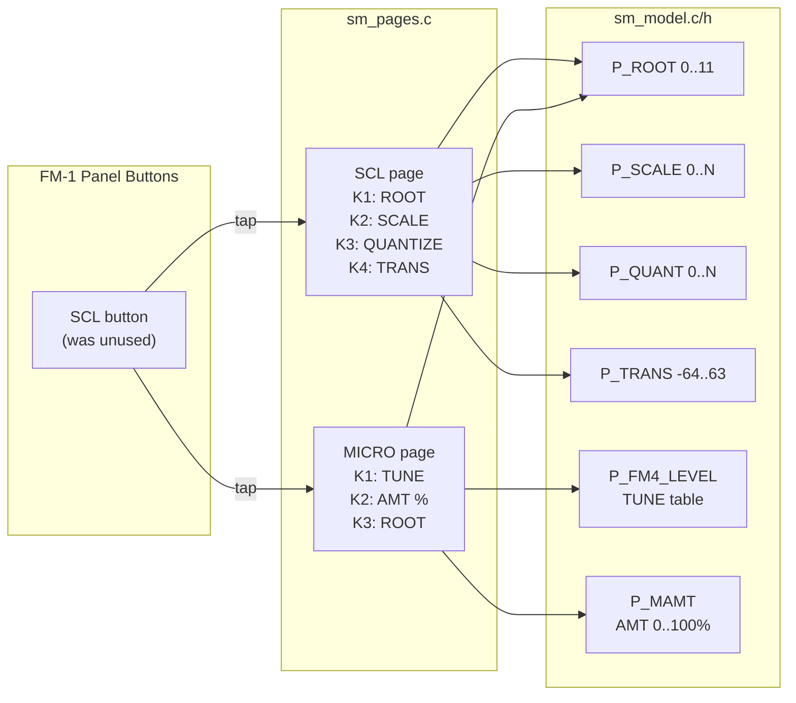

# Plan: Add SCL Pages to PULHRA

## Overview

Activate the currently unused **SCL** button on the FM-1 panel to provide two pages for scale/tuning control:

- **Page 1 (SCL)**: Scale selection — ROOT, SCALE, QUANTIZE, TRANS
- **Page 2 (MICRO)**: Microtonal tuning — TUNE (tuning table), AMT (amount 0-100%), ROOT

No layer is needed — just a tap of the SCL button cycles between the two pages.

## Files to Modify

### 1. `firmware/src/pulhra/sm_pages.c` — Add SCL family and pages

**a) Add `SMFAM_SCL` to the family enum** (line 15)

Current:
```c
enum { SMFAM_EDIT, SMFAM_GLO, SMFAM_ENV, SMFAM_LFO, SMFAM_SEQ, SMFAM_HOME, SMFAM_ARP, SMFAM_FX, SMFAM_VOICE, SMFAM_DEEP, SMFAM_EUCL, SMFAM_MENU,
       SMFAM_COUNT };
```

Change to:
```c
enum { SMFAM_EDIT, SMFAM_GLO, SMFAM_ENV, SMFAM_LFO, SMFAM_SEQ, SMFAM_HOME, SMFAM_ARP, SMFAM_FX, SMFAM_SCL, SMFAM_VOICE, SMFAM_DEEP, SMFAM_EUCL, SMFAM_MENU,
       SMFAM_COUNT };
```

**b) Add two new pages to `SM_PAGES[]`** (after line 56)

```c
    {"SCL", SMFAM_SCL, {P_ROOT, P_SCALE, P_QUANT, P_TRANS}, SM_NOPARAM},
    {"MICRO", SMFAM_SCL, {P_FM4_LEVEL, P_MAMT, P_ROOT, SM_NOPARAM}, SM_NOPARAM},
```

**c) Update `sm_fam_btn()`** (line 75-80) to map `SMFAM_SCL` to `B_SCL`

Current:
```c
static uint32_t sm_fam_btn(uint32_t fam)
{
    return fam == SMFAM_EDIT || fam == SMFAM_VOICE ? B_EDIT : fam == SMFAM_GLO ? B_GLO : fam == SMFAM_SEQ || fam == SMFAM_EUCL ? B_SEQ :
           fam == SMFAM_HOME || fam == SMFAM_MENU ? B_HOME : fam == SMFAM_ARP ? B_ARP : fam == SMFAM_FX || fam == SMFAM_DEEP ? B_FX :
           fam == SMFAM_LFO ? B_LFO : B_ENV;
}
```

Change to:
```c
static uint32_t sm_fam_btn(uint32_t fam)
{
    return fam == SMFAM_EDIT || fam == SMFAM_VOICE ? B_EDIT : fam == SMFAM_GLO ? B_GLO : fam == SMFAM_SEQ || fam == SMFAM_EUCL ? B_SEQ :
           fam == SMFAM_HOME || fam == SMFAM_MENU ? B_HOME : fam == SMFAM_ARP ? B_ARP : fam == SMFAM_FX || fam == SMFAM_DEEP ? B_FX :
           fam == SMFAM_LFO ? B_LFO : fam == SMFAM_SCL ? B_SCL : B_ENV;
}
```

### 2. `firmware/src/pulhra/sm_layer.c` — Add SCL to button table

**a) Update `SM_NLBTN`** (line 45) from 7 to 8

**b) Add SCL entry to `SM_LBTN[]`** (line 46-49)

Current:
```c
static const struct { uint8_t btn, layer, fam; } SM_LBTN[SM_NLBTN] = {
    {B_EDIT, SML_EDIT, SMFAM_EDIT}, {B_GLO, SML_GLO, SMFAM_GLO}, {B_SEQ, SML_SEQ, SMFAM_SEQ}, {B_HOME, SML_NONE, SMFAM_HOME},
    {B_FX, SML_NONE, SMFAM_FX}, {B_ARP, SML_NONE, SMFAM_ARP}, {B_LFO, SML_NONE, SMFAM_LFO},
};
```

Change to:
```c
static const struct { uint8_t btn, layer, fam; } SM_LBTN[SM_NLBTN] = {
    {B_EDIT, SML_EDIT, SMFAM_EDIT}, {B_GLO, SML_GLO, SMFAM_GLO}, {B_SEQ, SML_SEQ, SMFAM_SEQ}, {B_HOME, SML_NONE, SMFAM_HOME},
    {B_FX, SML_NONE, SMFAM_FX}, {B_ARP, SML_NONE, SMFAM_ARP}, {B_LFO, SML_NONE, SMFAM_LFO}, {B_SCL, SML_NONE, SMFAM_SCL},
};
```

### 3. `firmware/src/pulhra/sm_draw.c` — Verify rendering

The SCL and MICRO pages use standard track parameters (`P_ROOT`, `P_SCALE`, `P_QUANT`, `P_TRANS`, `P_FM4_LEVEL`, `P_MAMT`). The existing rendering code in `smd_knob_get()` and `smd_page()` should handle them automatically:

- **Knobs**: `smd_knob_get()` calls `sm_page_param()` which returns the parameter IDs from the page table, then `sm_desc_trk()` to get the descriptor, and renders the ring/value. This works for any track parameter.

- **Page title**: `smd_page()` — SCL pages have `fam == SMFAM_SCL` and `home == SMH_NONE` (0), so they fall into the `else` branch (line 316-320) which shows "PAGE · PRESET". This is correct behavior.

- **SELECT**: Both SCL and MICRO pages have `SM_NOPARAM` for SELECT, so `smd_select()` will show nothing (the `id == SM_NOPARAM` check at line 625 returns early). This is fine.

**No code changes needed** in `sm_draw.c` — the existing generic parameter rendering handles SCL/MICRO pages automatically.

### 4. `firmware/src/pulhra/sm_input.c` — Verify knob handling

The `sm_input_poll()` function handles pages in the `else` branch (line 1036-1047) for non-HOME, non-STEP, non-EUCLID, non-MIDI, non-SETUP pages:

```c
    } else {
        sm_preset_turn(pre);
        for (i = 0; i < 4; i++)
            if (sm_page_param(i) != SM_NOPARAM && k[i]) {
                sm_filt_auto(sm_page_param(i));
                sm_turn(sm_page_param(i), k[i]);
            }
        if (sm_page_param(4) != SM_NOPARAM && sel) {
            sm_filt_auto(sm_page_param(4));
            sm_turn(sm_page_param(4), sel);
        }
    }
```

SCL and MICRO pages will fall into this branch. The `sm_turn()` function handles track parameters correctly, including `P_FM4_LEVEL` (TUNE) and `P_MAMT` (AMT). The `sm_filt_auto()` call is harmless for non-filter parameters (it checks for `P_FLT` and returns early).

**No code changes needed** in `sm_input.c`.

### 5. `firmware/src/pulhra/sm_leds.c` — Verify SCL button LED

The LED code at line 151-155 iterates over all buttons and lights the family button:

```c
    sm_led_put(nl, panel.btn[sm_fam_btn(SM_PAGES[sm_ui.page % sm_page_count()].fam)], 1);
```

Since `sm_fam_btn()` will now return `B_SCL` for `SMFAM_SCL`, the SCL button will light up when on SCL or MICRO pages.

**No code changes needed** in `sm_leds.c`.

## Summary of Changes

| File | Change | Lines |
|------|--------|-------|
| `sm_pages.c` | Add `SMFAM_SCL` to enum | 1 line |
| `sm_pages.c` | Add 2 pages to `SM_PAGES[]` | 2 lines |
| `sm_pages.c` | Update `sm_fam_btn()` for SCL | 1 line |
| `sm_layer.c` | Update `SM_NLBTN` from 7 to 8 | 1 line |
| `sm_layer.c` | Add `{B_SCL, SML_NONE, SMFAM_SCL}` to `SM_LBTN[]` | 1 line |
| `sm_draw.c` | No changes needed (verify only) | — |
| `sm_input.c` | No changes needed (verify only) | — |
| `sm_leds.c` | No changes needed (verify only) | — |

**Total: ~6 lines changed across 2 files.**

## Architecture Diagram



## Testing

1. Press SCL button → should show "SCL" page with K1=ROOT, K2=SCALE, K3=QUANTIZE, K4=TRANS
2. Press SCL again → should show "MICRO" page with K1=TUNE, K2=AMT, K3=ROOT
3. Press SCL again → should cycle back to "SCL" page
4. Verify SCL button LED lights up on both pages
5. Verify knob turns modify the correct parameters
6. Verify PRESETS knob still works (changes machine presets)
7. Verify ALGORITHM knob still selects track