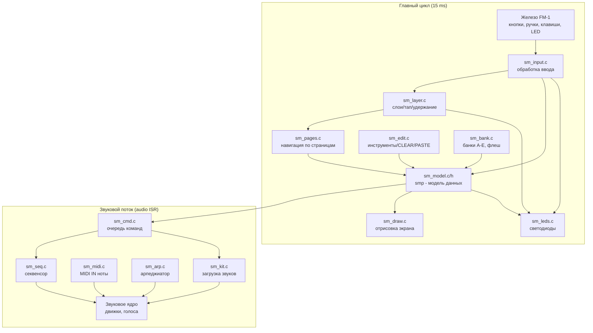

# План реализации UI PULHRA

## Обзор

PULHRA — минималистичный «Elektron-форк» для M-VAVE FM-1: четыре трека, 40 паттернов (5 банков × 8), сетка из 16 шагов, параметрические локи, цепи шагов. Интерфейс строится на принципах Elektron-секвенсоров: **страницы**, **четыре ручки K1–K4 + SELECT**, **клавиши-триги**, **слои на удержание** и **SHIFT-комбинации**.

Документ `ui_desk_PULHRA.md` описывает полную спецификацию UI. Ниже — план реализации, разбитый на этапы и конкретные задачи.

**Статус: ВСЕ этапы 1–10 реализованы.** Файлы находятся в `firmware/src/pulhra/`. Остаётся этап 11 (веб-эмулятор).

---

## Этап 1: Ядро модели данных и базовая архитектура ✅

### 1.1 Модель данных (`sm_model.h` / `sm_model.c`) ✅
- [x] Определить структуры: `sm_step_t` (триг), `sm_lock_t` (лок), `sm_sound_t` (звук трека), `sm_kit_t` (комплект), `sm_pattern_t` (паттерн), `sm_project_t` (проект)
- [x] Реализовать `sm_project_t smp` — единственный экземпляр модели
- [x] Определить константы: `SM_NTRK=4`, `SM_NBANK=5`, `SM_BPAT=8`, `SM_NGPAT=40`, `SM_NSTEP=32`, `SM_NLOCK=192`, `SM_NCHAIN=16`
- [x] Реализовать `sm_sound_from_preset()` — загрузка пресета машины в звук
- [x] Реализовать `sm_val_turn()` — поворот параметра с учётом диапазона и списков (INSERT TYPE)
- [x] Реализовать `sm_engine_of()` — маппинг машины → движок

### 1.2 Командная очередь (`sm_cmd.c`) ✅
- [x] Определить типы команд: `SMC_PLAY`, `SMC_STOP`, `SMC_PARAM`, `SMC_LOAD`, `SMC_UNLOCK`, `SMC_PREVIEW`, `SMC_KEYON`, `SMC_KEYOFF`
- [x] Реализовать кольцевой буфер команд (`sm_cq`, `sm_cov`) с lock-free producer/consumer
- [x] Реализовать `sm_cmd_push()` / `sm_cmd_drain()` с коалесценцией параметров
- [x] Реализовать `SM_BARRIER()` для безопасного обмена между главным циклом и звуковым потоком

### 1.3 Загрузка кита в звуковое ядро (`sm_kit.c`) ✅
- [x] Реализовать `sm_track_load()` — копирование звука из модели в `trk[]`
- [x] Реализовать `sm_kit_boot()` — инициализация 4 треков при старте

---

## Этап 2: Страницы и базовая навигация ✅

### 2.1 Таблица страниц (`sm_pages.c`) ✅
- [x] Определить структуру `sm_page_t`: имя, семейство, 4 параметра K1–K4, SELECT, тип HOME-страницы
- [x] Реализовать таблицу `SM_PAGES[]` со всеми страницами:
  - EDIT 1, EDIT 2, AMP, MIX, FILTER, F.ENV, STEP
  - MIXER, CLOCK, ARP, ARP 2
  - FX, DIST, INSERT
  - VOICE, DLY, REV, CHORUS, EUCLID, MENU
- [x] Реализовать `sm_page_press(fam)` — навигация по семействам (тап = следующая страница по кругу)
- [x] Реализовать `sm_page_param(k)` — получение ID параметра для ручки K1–K4/SELECT с учётом HYB-фильтра
- [x] Реализовать `sm_cur_page()` / `sm_page_count()` / `sm_page_home()`
- [x] Реализовать FLAG-список для STEP-страницы (`SM_FLAGV`, `SM_FLAGN`, `sm_flag_place()`)
- [x] Реализовать COND-список для STEP-страницы (`sm_cond_of_place()`, `sm_cond_place()`, `sm_cond_ab()`, `sm_cond_name()`)

### 2.2 Состояние UI (`sm_ui` в `sm_pages.c`) ✅
- [x] Определить глобальное состояние: `page`, `trk`, `held_step`, `bank`, `sel_step`, `kbd`, `oct`
- [x] Определить `sm_layer` — текущий открытый слой (EDIT/GLO/SEQ/NONE)
- [x] Определить `sm_rec` — состояние записи
- [x] Определить `sm_dirty` — флаг перерисовки экрана

---

## Этап 3: Ввод (кнопки, ручки, клавиши) ✅

### 3.1 Обработка ввода (`sm_input.c`) ✅
- [x] Реализовать `sm_input_init()` — инициализация состояния ввода
- [x] Реализовать опрос энкодеров: MASTER, SELECT, PRESETS, ALGORITHM, K1–K4
  - Детент = полный квадрантный цикл (4 перехода)
  - Антидребезг: взаимное вычитание «туда-сюда»
- [x] Реализовать опрос кнопок с асимметричным дебаунсом:
  - Нажатие: ~2 кадра замкнуто
  - Отпускание: ~8 кадров разомкнуто (~9 мс)
- [x] Реализовать опрос 27 клавиш F3…G5
- [x] Реализовать `sm_oct_poll()` — обработка OCT−/OCT+:
  - Одновременное нажатие (< 100 мс) = режим клавиатуры
  - Одиночное = SHIFT (OCT−) / листание страниц шагов (OCT+)

### 3.2 Grid record (триги) ✅
- [x] Реализовать логику тригов:
  - REC выключен: клавиши не трогают шаги
  - REC включён: тап клавиши (< 0.35 с) = переключение трига при отпускании
  - Удержание (> 0.35 с) = выбор шага (просмотр/локировка)
  - Поворот ручки при зажатой клавише = лок (клавиша помечается «использованной»)
- [x] Реализовать `sm_step_toggle()` — переключение трига
- [x] Реализовать копирование/вставку трига: SHIFT + клавиша / удержание + OCT+

### 3.3 Параметрические локи (`sm_lock.c`) ✅
- [x] Реализовать `sm_lock_find()` — поиск лока в пуле
- [x] Реализовать `sm_lock_set()` / `sm_lock_remove()` — установка/удаление лока
- [x] Реализовать `sm_lock_compact()` — дефрагментация пула (на стопе)
- [x] Реализовать `sm_param_locked_any()` — проверка, залочен ли параметр на любом шаге
- [x] Реализовать систему сообщений в шапке: `sm_msg_put()` / `sm_msg_poll()` (LOCKS FULL, CLEARED, UNDO, SAVED, FLASH ERROR, SHIFT, TRN)

### 3.4 SHIFT-комбинации ✅
- [x] Реализовать `sm_shift` — состояние SHIFT (OCT− зажата вне режима клавиатуры и слоёв)
- [x] SHIFT + ручка: ускорение ×4/×8 для широких диапазонов
- [x] SHIFT + EDIT → страница VOICE
- [x] SHIFT + FX → DLY → REV → CHORUS по кругу
- [x] SHIFT + SEQ → страница EUCLID
- [x] SHIFT + HOME → страница MENU
- [x] SHIFT + SAVE → быстрое сохранение
- [x] SHIFT + D#4/F#4 → сдвиг тригов трека −1/+1
- [x] SHIFT + D#5/F#5 → транспонирование −1/+1 полутон

### 3.5 Страница STEP ✅
- [x] Реализовать `sm_step_page()` — редактирование полей шага:
  - С выбранным шагом: K1 NOTE, K2 VEL, K3 LEN, K4 COND, SELECT NUDGE, PRESETS FLAG
  - Без выбранного шага: значения трига по умолчанию и SWING трека
- [x] Реализовать наследование полей (SM_INH): пока поле не правили на шаге, оно берётся из дефолтов трека

### 3.6 Режим клавиатуры ✅
- [x] Реализовать включение/выключение: OCT− + OCT+ одновременно
- [x] Все 27 клавиш играют ноты выбранного трека (F3 = MIDI 53)
- [x] OCT−/OCT+ = октава −3…+3
- [x] Выход из режима отпускает все ноты

### 3.7 Живая запись (live record) ✅
- [x] Реализовать `sm_lrec_poll()` — запись нажатых клавиш/MIDI в триги:
  - Первая половина шага → в этот шаг, вторая → в следующий
  - VEL = 100, LEN = длительность нажатия
  - До 4 нот в пределах шага = аккорд
- [x] Реализовать кольцо событий `sm_rev` для передачи ON/OFF от звукового потока к главному циклу

### 3.8 Управление темпом и свингом ✅
- [x] BPM: 30.0–300.0, шаг 0.1 (SHIFT: 1.0), ускорение при быстром повороте
- [x] SWING: 50–75 %, свой свинг у каждого трека
- [x] SELECT на CLOCK = темп

---

## Этап 4: Слои на удержание ✅

### 4.1 Механизм слоёв (`sm_layer.c`) ✅
- [x] Реализовать `sm_layer_poll()` — определение тап/удержание:
  - Удержание дольше HOLD (300–600 мс из меню)
  - «Использование» клавиши/ручки при зажатой кнопке = слой
  - Отпускание без слоя = тап (страница меняется в момент отпускания для EDIT/GLO)
- [x] Реализовать `sm_layer_busy()` — проверка, открыт ли слой

### 4.2 Слой EDIT — машины ✅
- [x] Белые клавиши F3…: машины страницы (MONO, SOMA, SLICE)
- [x] OCT+ = следующая страница машин
- [x] G5 = INIT (пресет 0 текущей машины)
- [x] Длина трека при смене машины сохраняется

### 4.3 Слой GLO — банк, мьюты, соло, FILL ✅
- [x] Чёрные F#3 G#3 A#3 C#4 = мьют T1–T4
- [x] Белые F3–B3 = соло T1–T4 (пока держишь)
- [x] G5 = FILL (пока держишь)
- [x] Сетка банка: чёрные G#4…F#5 = банк A–E, белые C4–C5 = паттерны 1–8
  - Тап по пустому = сохранить текущий паттерн
  - Тап по занятому = переключиться
  - Удержание ≥ 0.8 с = пересохранить

### 4.4 Слой SEQ — инструменты ✅
- [x] K1 = длина трека 1–32, K2 = мастер-длина паттерна (AUTO или 1–128)
- [x] Белые клавиши: CLEAR, COPY/PASTE паттерна/трека, SHIFT шагов, TRN
- [x] F#3 = режим смены паттерна (SEQUENTIAL / DIR START / DIR JUMP)
- [x] ALGORITHM = выбор паттерна из всех 40
- [x] Цепочка: OCT+ добавить, OCT− сбросить, G#3 выключить
- [x] F#5 держать 0.8 с = SAVE
- [x] UNDO: держать SAVE (один уровень)

### 4.5 Удержания без слоя ✅
- [x] HOME держать + F3…B3 = выбор трека T1–T4
- [x] ARP держать + F3 = LATCH нот клавиатуры

---

## Этап 5: Экран и отрисовка ✅

### 5.1 Пиксельные примитивы (`sm_px.c`) ✅
- [x] Реализовать `sm_px_text()` — вывод текста шрифтом 5×7, scale 2, инверсия
- [x] Реализовать `sm_px_ring()` — кольцо из 16 точек (3×3), 270°, заливка/лока/дим

### 5.2 Шрифт (`sm_font.c`) ✅
- [x] Таблица глифов 5×7 (ASCII 32…95 + спецсимволы 0x10…0x12)
- [x] Производный от Adafruit GFX, BSD-2-Clause

### 5.3 Отрисовка экрана (`sm_draw.c`) ✅
- [x] Реализовать зональную перерисовку (8 зон: header, page, 4 knobs, SELECT, strip)
- [x] **Шапка** (y 0..19): трек, машина, пресет; паттерн, темп, PLAY; REC (ARM/REC); сообщения
- [x] **Строка страницы** (y 20..47): имя страницы, имя пресета; в слое — карта слоя
- [x] **4 кольца** (y 48..159): K1–K4, 16 точек, заливка при локе
- [x] **SELECT** (y 168..187): метка и значение
- [x] **Полоса шагов** (y 220..239): 16 точек, триг/стопка/REST/пусто, играющий/зажатый шаг
- [x] **Карта слоя**: 5 рядов по 34 px, метки клавиш
- [x] **HOME > MIXER**: 4 трека, ряды точек, LEVEL кольца
- [x] Реализовать `sm_ux_mk1()` — цвета Elektron mk1 (белое на чёрном, тусклое 0x4208)

---

## Этап 6: Светодиоды ✅

### 6.1 Управление LED (`sm_leds.c`) ✅
- [x] Реализовать `sm_led_pos_init()` — маппинг ID кнопок/клавиш в колонки/ряды
- [x] Реализовать `sm_led_put()` / `sm_led_clear()` — установка/снятие LED
- [x] **Белые клавиши**: триг = горит, REST = дышит, пусто = тёмный
- [x] **Играющий шаг**: мягкая бегущая подсветка (MID)
- [x] **OCT+**: горит на странице 17–32
- [x] **OCT−**: горит при SHIFT
- [x] **Кнопка семейства**: горит для текущей страницы
- [x] **REC**: ровно при ARM, дышит при REC
- [x] **PLAY**: зелёный при игре
- [x] **Слой**: кнопка дышит, клавиши показывают действия слоя
- [x] Настройка LEDS: OFF / DIM LO / DIM HI / INV

---

## Этап 7: Банки и сохранение ✅

### 7.1 Банки в RAM (`sm_bank.c`) ✅
- [x] Два банка в RAM (две половины по 8 слотов), `smp.hbank[]`
- [x] Загрузка банка из флеша в свободную половину
- [x] Переключение паттерна: `smp.next` → звуковой поток переключает на границе
- [x] «Грязные» банки: хэш при загрузке, сравнение при правках

### 7.2 Флеш-память ✅
- [x] Формат: проект (2 копии A/B по сектору), банки (пул из 7 мест по 5 секторов)
- [x] Заголовок: magic "SWB1", version, bank, used, seq, size, crc32, hcrc
- [x] Запись: данные → заголовок → верификация чтением
- [x] Выбор места: не новейшая копия ни одного банка
- [x] Восстановление при включении: новейшая целая копия по seq и CRC

### 7.3 Сохранение ✅
- [x] SAVE: SEQ + F#5 держать 0.8 с (или SHIFT + SAVE)
- [x] Автосейв: 8 с без правок и без звучащих нот, на стопе
- [x] Объект проекта: BPM, swing, мьюты, режим смены, цепочка, текущий паттерн, глобальные эффекты
- [x] Версионирование проекта: v1 (24 Б) → v2 (+9 int16 для глобальных эффектов)

---

## Этап 8: Секвенсор и звуковой поток ✅

### 8.1 Секвенсор (`sm_seq.c`) ✅
- [x] Единый ход шестнадцатых для 4 треков
- [x] Каждый трек зацикливается по своей длине (1–32)
- [x] `sm_seq_fire()` — запуск трига: COND, locks, notes, VEL, LEN
- [x] SLIDE: легато с глайдом до следующего трига
- [x] Ратчет x2–x4: деление шага на равные части
- [x] PSLIDE: линейная интерполяция локов между тригами
- [x] SWING: сдвиг каждой второй шестнадцатой
- [x] NUDGE: сдвиг трига в пределах шага (−8…+7)
- [x] LIVE RECORD: `sm_rec_on()` / `sm_rec_off()` — запись нот в триги

### 8.2 MIDI IN (`sm_midi.c`) ✅
- [x] Каналы 1–4 → треки T1–T4
- [x] Раздельные книги нот: секвенсор, MIDI, клавиатура, арпеджиатор
- [x] Mute/solo: не запускать новые ноты, отпускать звучащие
- [x] STOP/паника: отпустить все MIDI-ноты

### 8.3 Арпеджиатор (`sm_arp.c`) ✅
- [x] 14 режимов: OFF, UP, DN, UPDN, RND, ORD, REPEAT, DNUP, UP+8, CONV, DIVG, PINKY, THUMB, WALK, CHORD
- [x] RATE, OCT, GATE, SWING, PROB, LATCH, ORDER
- [x] Свои часы на трек (q8 сэмплы от начала блока)
- [x] Своя книга нот (sm_ar), не пересекается с секвенсором/MIDI/клавиатурой
- [x] REC + игра: запись нот арпа в триги

---

## Этап 9: Редактирование треков и паттернов ✅

### 9.1 Инструменты (`sm_edit.c`) ✅
- [x] CLEAR трека/всех треков
- [x] COPY/PASTE паттерна
- [x] COPY/PASTE трека
- [x] SHIFT шагов влево/вправо по кругу
- [x] TRN нот −1/+1 полутон
- [x] Буфер обмена (`sm_clip`) и UNDO (`sm_undo_buf`) в `.noinit`
- [x] Безопасная перезапись во время игры: `sm_put_begin()` → `sm_put_track()` → барьер

### 9.2 Генерация евклида ✅
- [x] Страница EUCLID: K1 STEPS, K2 HITS, K3 ROT
- [x] OCT+ = генерация тригов в выбранный трек
- [x] Алгоритм: равномерное распределение HITS ударов по STEPS местам

---

## Этап 10: Главный цикл и инициализация ✅

### 10.1 Главный цикл (`sm_main.c`) ✅
- [x] `fm1_timer5_irq()` — 10 kHz прерывание: скан ввода, USB, UART
- [x] `sm_input_poll()` — опрос ввода (15 ms цикл)
- [x] `sm_draw()` — отрисовка экрана
- [x] Загрузка настроек: `sm_settings_load()`
- [x] Проверка `.noinit` (буферы UNDO и clipboard)

### 10.2 Сборка приложения (`sm_app.c`) ✅
- [x] `sm_core_init()` — инициализация всего: модель, звуковое ядро, секвенсор, ввод, слои, банки
- [x] Подключение всех модулей: sm_model, sm_kit, sm_cmd, sm_seq, sm_midi, sm_arp, sm_pages, sm_lock, sm_bank, sm_input, sm_edit, sm_layer, sm_font, sm_px, sm_draw, sm_leds

---

## Этап 11: Веб-эмулятор ⬜

### 11.1 HTML/JS эмулятор (`web/emu/index.html`) ⬜
- [ ] SVG-панель с кнопками, ручками, клавишами (существует для Felucca, требуется адаптация под PULHRA)
- [ ] Canvas 240×240 для экрана (существует)
- [ ] WebAssembly-сборка (`felucca.wasm`) через WebAudio (worklet.js) (существует для Felucca)
- [ ] Два макета: wide (FM-1 layout) и tall (телефон)
- [ ] Поддержка клавиатурных сокращений (Z-', Q-O, 1-=, [, ], стрелки)
- [ ] Shift+клик = удержание кнопки

---

## Сводная диаграмма архитектуры



---

## Приоритеты реализации

| Приоритет | Этап | Статус |
|-----------|------|--------|
| P0 | Этап 1 (модель + команды + кит) | ✅ |
| P0 | Этап 2 (страницы) | ✅ |
| P0 | Этап 3 (ввод) | ✅ |
| P1 | Этап 4 (слои) | ✅ |
| P1 | Этап 5 (экран) | ✅ |
| P1 | Этап 6 (LED) | ✅ |
| P2 | Этап 7 (банки) | ✅ |
| P2 | Этап 8 (секвенсор) | ✅ |
| P2 | Этап 9 (редактирование) | ✅ |
| P3 | Этап 10 (главный цикл) | ✅ |
| P3 | Этап 11 (веб-эмулятор) | ⬜ |

---

## Файловая структура (текущая)

```
firmware/src/pulhra/
├── sm_app.c          # Сборка приложения, инициализация ✅
├── sm_arp.c          # Арпеджиатор ✅
├── sm_bank.c         # Банки A-E, флеш, SAVE/автосейв ✅
├── sm_cmd.c          # Командная очередь (main loop → audio stream) ✅
├── sm_draw.c         # Отрисовка экрана (Elektron mk1) ✅
├── sm_edit.c         # Инструменты: CLEAR, COPY/PASTE, SHIFT, TRN, UNDO ✅
├── sm_font.c         # Пиксельный шрифт 5×7 ✅
├── sm_input.c        # Ввод: кнопки, ручки, клавиши, grid record, live record ✅
├── sm_kit.c          # Загрузка кита в звуковое ядро ✅
├── sm_layer.c        # Слои на удержание (EDIT, GLO, SEQ) ✅
├── sm_leds.c         # Светодиоды панели ✅
├── sm_lock.c         # Параметрические локи ✅
├── sm_main.c         # Главный цикл, TIMER5 IRQ ✅
├── sm_midi.c         # MIDI IN (ноты) ✅
├── sm_model.c        # Модель данных: проект, звуки, пресеты ✅
├── sm_model.h        # Определения структур и констант ✅
├── sm_pages.c        # Таблица страниц, навигация, FLAG/COND ✅
├── sm_px.c           # Пиксельные примитивы (текст, кольца) ✅
└── sm_seq.c          # Секвенсор (звуковой поток) ✅